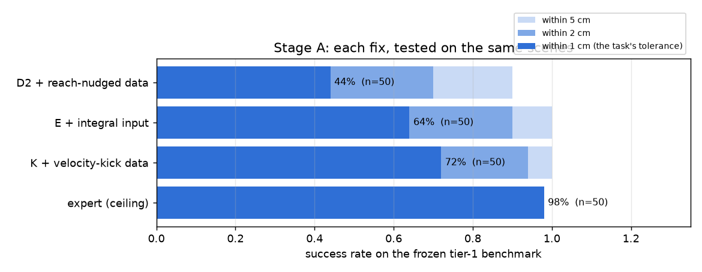
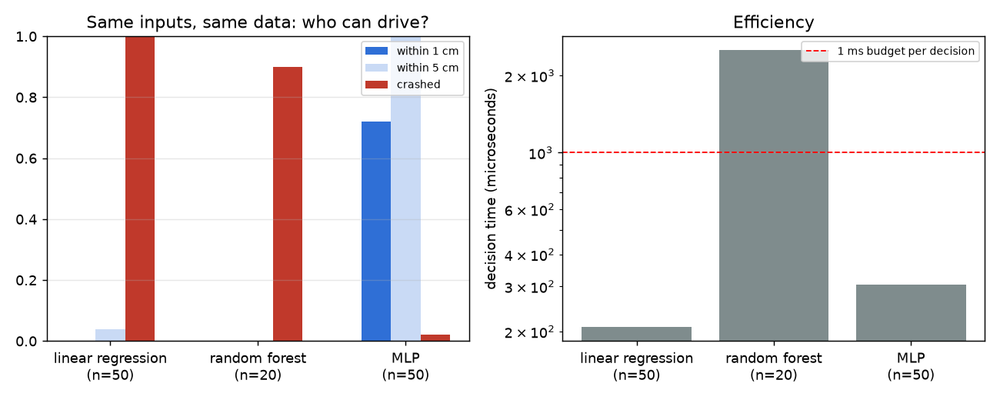
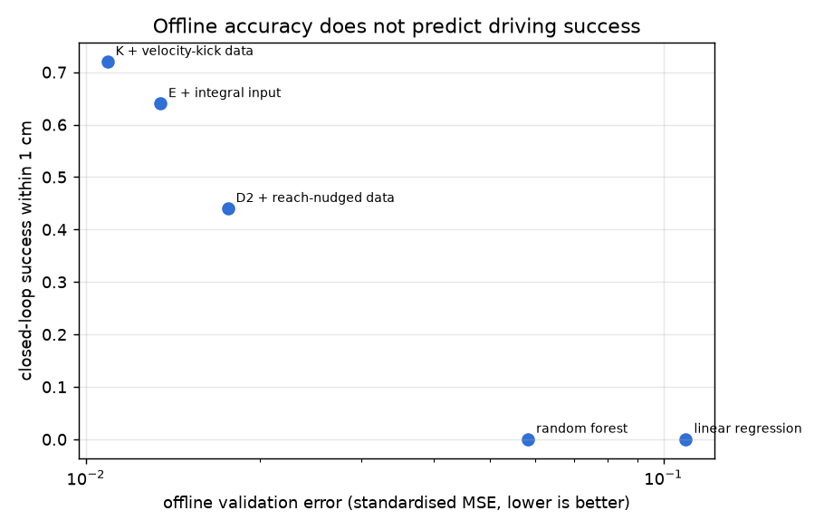
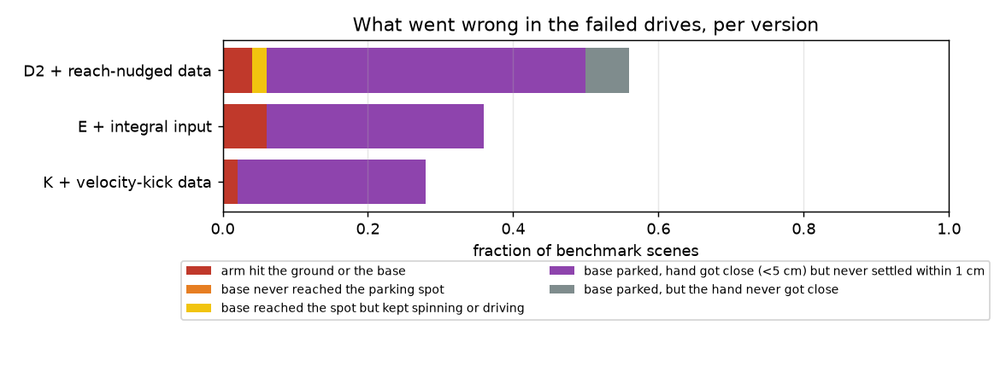
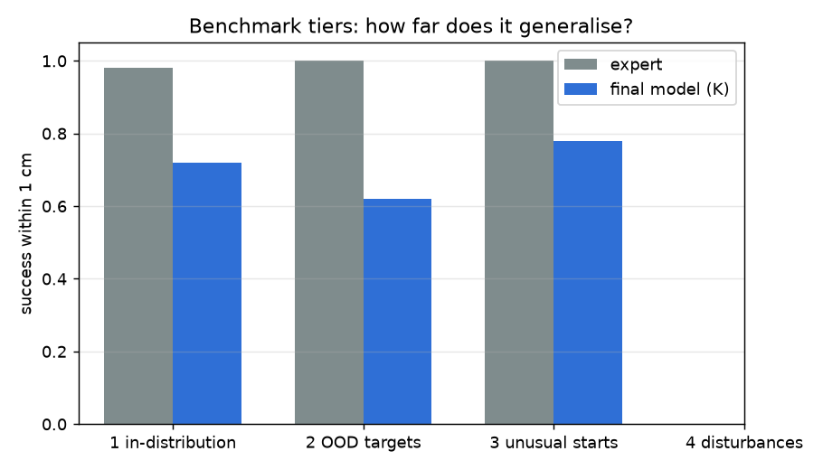

# COMP0245 behaviour cloning: a mobile manipulator learns to reach

A neural network that copies the template's expert controller for the Robotnik base + Kinova arm:
it maps **(base pose, arm joint angles and speeds, target)** to **(4 wheel speeds, 7 arm torques)**
every millisecond, and drives the robot to the red dot on its own.

**Result on the frozen benchmark (50 unseen normal scenes):**

| | within 1 cm (the task's tolerance) | within 2 cm | within 5 cm | crashes |
|---|---|---|---|---|
| Expert controller (ceiling) | 98% | 98% | 98% | 0 |
| **Final model K** (two training seeds) | **72%, 68%** | 94%, 96% | 100%, 100% | 1, 1 |
| First attempt (plain copy, v0) | 0% | 0% | 0% | 50 |

The gap between v0 and K is seven design changes, each tested on the same scenes (section 4).

---

## 1. Setup

Works on Windows, Linux and macOS inside the course's RoboEnv environment.

```powershell
# once: link the robot models from your RoboEnv checkout (PowerShell, inside this folder)
New-Item -ItemType Junction -Path .\models -Target "C:\Users\YOU\...\RoboEnv\models"
#   Linux / macOS:  ln -s /path/to/RoboEnv/models models

# every session: enter the environment, then work from this folder
cd C:\Users\YOU\...\RoboEnv
pixi shell
cd C:\path\to\comp0245_bc
```

`configs/robotnik_arm.json` is included. The recorded data, trained models and results are on
OneDrive: *(add link)*. Unzip `data/` and `results50/` next to the code to skip recording and testing.

**Training needs PyTorch**, which lives in RoboEnv's `ml` environment: run training as
`pixi run -e ml python train.py ...` (from the RoboEnv folder) or inside `pixi shell -e ml`.
Everything else (recording, driving, figures) runs in the default environment: no PyTorch needed to
drive, the trained weights are plain NumPy arrays.

## 2. Quick start: three commands

```powershell
python expert_episode.py                                      # 1 expert run on the template's own scene
#   expect: Outcome: reached | final error 0.21 cm | time 8.00 s      (identical to the template)
python evaluate.py --policy trained\vK_kick.npz --tiers 1 --n 10 --workers 3
#   the final model drives 10 benchmark scenes (~2 min); expect about 7/10 reached
python compare.py --results results --policies expert vK_kick        # the results table
```

To watch a drive instead of reading numbers: `python -c "from rollout import *; rollout(MLPPolicy('trained/vK_kick.npz'), {'seed':0,'target':[0,1.1,0.5],'start_pose':[0,0,0]}, use_gui=True)"`.

## 3. The pipeline, file by file

| Step | File | What it does |
|---|---|---|
| Expert | `robotnik_arm_control.py` | The template's controllers, **unchanged** (base: P + phases; arm: PD + gravity) |
| 1 Record | `expert_episode.py` | The template's loop as a function: one run, random target and start, logged at 100 Hz, one `.npz` per run. Options for nudged and kicked recordings |
| | `collect.py` | Records a block of seeds in parallel; resumable |
| | `check_runs.py` | Summary table and plots of recordings; `load_run()` used everywhere |
| | `samplers.py` | Training ranges, held-out ranges, and the frozen benchmark scene generator |
| 2 Prepare | `make_benchmark.py` | Generates the 200 benchmark scenes once (seeds 1,000,000+) and refuses to overwrite them |
| | `make_split.py` | Splits runs 70/15/15 **by run**; saves the run IDs so everyone uses the same split |
| | `features.py` | Measurements -> the 50 model inputs (basic, history, parking spot, integral) |
| 3 Train | `train.py` | Trains MLP / linear / forest with every design switch; exports NumPy weights |
| 4 Drive | `rollout.py` | A policy (expert, model, or hybrid) drives one scene; returns metrics |
| | `evaluate.py` | Runs a policy on benchmark scenes (parallel), writes CSV + plots |
| 5 Analyse | `compare.py` | Results table for all policies (text or markdown) |
| | `analyse_failures.py` | Sorts every failed drive into one of five reasons |
| | `make_figures.py` | All report figures from the results tables |
| Support | `quiet.py` | Hides simulator spam; crashes become one line + `error.log` |
| | `DATA_FORMAT.md` | Every field in a recording file |

Folders: `data/` recordings (`runs` clean, `runs_nudged`, `runs_reach`, `runs_kick`), `benchmark/`
the frozen scenes, `splits/`, `trained/` models, `results50/` benchmark results, `figures/`.

## 4. The ladder: every version, same 50 scenes



| Version | One change | Within 1 cm | What happened |
|---|---|---|---|
| v0 | plain copy of the expert's commands | 0/50 | arm collapses onto the ground within seconds |
| v1 | network learns **torque minus gravity**; physics supplies gravity | 0/50 | arm no longer collapses, drifts slowly into the base |
| v1+h | + **history** inputs (motion over 0.1 s / 0.5 s) | 0/50 | base now drives properly; arm still drifts |
| v2 | + **nudged recordings** (expert recovering from pushes) | 0–1/50 | no crashes; reaches to ~10 cm, wobbles |
| A | + **parking-spot** inputs | 2/10 | base stops instead of spinning |
| D | + **separate arm/wheel nets** + **reach weighting** | 4/10 | hand within 1–4 cm, never settles |
| D2 | + **reach-nudged recordings** (fine corrections) | 19–28/50 | 1 cm reached often; 3 crashes late in the drive |
| E | + **integral inputs** (error averaged over 0.5 s / 2 s) | 25–32/50 | steady-state error closed; 3 crashes remain |
| **K** | + **velocity-kick recordings** (recovery from motion) | **34–36/50** | crashes 3 → 1, seeds agree |

Where a range is given, the version was trained with 2–3 random seeds; seed-to-seed spread was
±10 points for D2, but only ±2 for K. Exact numbers: `results50/*.csv`, `python compare.py --results results50`.

### Why each change (the reasoning markers will ask about)

1. **Gravity by physics.** Most arm torque just holds the arm up. The robot model computes that
   exactly, so the network only learns the small correction on top (lab 1: use the physics you know).
2. **History.** The expert has hidden state (turning vs driving phase, a creeping arm reference).
   Recent motion reveals the phase without using the expert's internals.
3. **Nudged recordings.** Clean runs only show the perfect path; the first mistake puts the model
   somewhere it has never seen and errors compound (Ross et al. 2011). Nudging the executed command
   while recording the expert's clean response teaches recovery (DART, Laskey et al. 2017).
4. **Parking-spot inputs.** The expert's "stop" is a hard switch on reaching its parking spot. The
   spot follows from the target by the template's formula, so the model is told where it is.
5. **Separate networks, reach weighting.** Arm and wheels are different problems; reaching is a
   small slice of each run but decides success. Neither helped alone; both helped once the base parked.
6. **Reach-nudged recordings.** The last centimetre needs many examples of fine corrections.
7. **Integral inputs.** The model acted like a P controller: it stopped 1–3 cm short (steady-state
   error). The expert avoids this with a reference that keeps creeping. Averaging the error over
   time gives the model integral action from measurements alone (PID, lab 3).
8. **Velocity-kick recordings.** Remaining crashes happened when the arm picked up speed never
   seen in training (4–6 standard deviations out), then ran away. Kicking the arm while recording
   adds recovery-from-motion examples. Crashes fell 3 → 1 and the seeds agreed.

### Things that did NOT help (and are in the report as ablations)

| Tried | Result | Why |
|---|---|---|
| Wheel speeds as inputs | 0–9/50 | the model copies the current speed as its next command (the copycat shortcut) and never stops turning |
| Model outputs an arm reference, fixed PD makes torque | 26/50 (vs 32) | no gain over predicting torque; also outside the brief's outputs |
| Clipping inputs to the training range | no change | the runaway was in joint speed, which clipping cannot stop once the arm is moving |

### Model comparison (same inputs, same data, same scenes)



| Model | Within 1 cm | Crashes | Decision time |
|---|---|---|---|
| Linear regression | 0/50 | 50/50 | 0.2 ms |
| Random forest (20 trees, depth 12) | 0/20 | 18/20 | 2.5 ms (over the 1 ms budget) |
| MLP (K) | 34–36/50 | 1/50 | 0.3 ms |

Offline, the ranking is the same (validation error: MLP 0.19 Nm, forest 0.36, linear 0.47), but
offline error understates the gap enormously: a model 2x worse offline is unusable in closed loop.
Trees give step-shaped outputs; at 1,000 decisions a second every step is a kick to the arm.



### Where the final model still fails



Of K's 14–16 failures on 50 scenes, all but one are "base parked, hand within 1–2 cm, never inside
1 cm". The base never fails any more. The one crash (scene 40, both seeds) is a low target where
the arm drifts after hovering.

## 5. The benchmark (200 frozen scenes, `benchmark/scenes.json`)

Generated once before any training, from a seed block (1,000,000+) that cannot overlap the training
seeds, and never changed since. Every policy, including the expert, runs on exactly these scenes.

| Tier | Scenes | What changes | What it tests |
|---|---|---|---|
| 1 | 50 | new targets and starts inside the training ranges | accuracy |
| 2 | 50 | targets higher (1.10–1.25 m) or farther (2.0–2.5 m) than any in training | generalisation |
| 3 | 50 | starts far away facing the wrong way, or right next to the parking spot | compounding errors, the expert's own weak spot |
| 4 | 50 | tier-1 scenes plus sensor noise (std 0.005–0.02) and a 1–4 ms command delay | robustness |

Metrics per scene: reached (hand within 1 cm), closest approach, final distance, time, crash,
command jerk, decision time, and where the base ended. Success is also reported at 2 cm and 5 cm,
with 95% confidence ranges, because 50 scenes leave ±13 points of uncertainty.



Tier 2–4 results: `python compare.py --results results50 --tier 2` (and 3, 4).

**A disturbance we had to drop.** Tier 4 originally also shoved the base sideways (100–300 N for
0.1 s). The *expert* then failed 47 of 50 scenes: once pushed off its heading it never re-enters
its "align" phase and drives in a circle, the same orbit failure seen in 2 of the 300 clean
recordings. A delay of 6 ms or more crashes it as well. A benchmark the teacher cannot pass says
nothing about the student, so tier 4 keeps only disturbances the expert survives. Both findings
are expert limitations worth stating: the clone can at best inherit them.

## 6. Data

| Set | Runs | How recorded | Used for |
|---|---|---|---|
| clean | 300 (297 usable) | expert undisturbed, random target and start | train / val / test split |
| nudged | 150 (91 usable) | held random offset on the executed command | training only |
| reach-nudged | 120 (101 usable) | offsets only while the arm is reaching | training only |
| kicked | 120 (119 usable) | 50 ms torque pulses while reaching | training only |

Validation is always the same 45 clean runs, so every version is comparable. The 44 clean test runs
are kept for offline scores only; the benchmark scenes are the real test. One file per run, 100 Hz,
`float32`; field list in `DATA_FORMAT.md`. Seeds are saved in every file, so any run can be replayed.

**Expert failures found while recording:** the base can orbit its parking spot when it starts close
to it (tightest drivable circle ~0.8 m); 2 of 300 clean runs failed this way and are excluded.
The template labels a run "stalled" before checking "reached", so a run within tolerance can be
mislabelled (seed 189); success is judged on the final error instead.

## 7. Reproducing everything from scratch

```powershell
python make_benchmark.py                                                   # frozen scenes (already included)
python collect.py --start 0 --end 300 --workers 3                          # clean runs      (~15 min)
python collect.py --start 10000 --end 10150 --noise 0.05 0.1 0.15 --workers 3 --out data\runs_nudged
python collect.py --start 20000 --end 20120 --noise 0.05 0.1 --nudge-when reach --workers 3 --out data\runs_reach
python collect.py --start 30000 --end 30120 --kick 0.02 --workers 3 --out data\runs_kick
python make_split.py
pixi run -e ml python train.py --name vK_kick --history deltas --goal --separate --reach-weight 3 --integral --extra-train data\runs_nudged data\runs_reach data\runs_kick
python evaluate.py --policy expert            --tiers 1 2 3 4 --n 50 --workers 3 --out results50
python evaluate.py --policy trained\vK_kick.npz --tiers 1 2 3 4 --n 50 --workers 3 --out results50
python compare.py --results results50 --markdown
python analyse_failures.py --results results50 --policies vK_kick
python make_figures.py
```

Earlier ladder versions: `train.py` with fewer switches (see its docstring), e.g. v0 is
`--torque raw`, v1 is the default, E drops `data\runs_kick`. Results differ by a scene or two
between machines (floating point, package versions); the picture does not. Use the trained models
in `trained/` for exact numbers.

## 8. When things go wrong

- Simulator warnings are hidden; `$env:ROBOENV_VERBOSE = "1"` shows them.
- A failed recording is listed as `error` with details in `data/runs/failures.log`; rerun to retry.
- Any crash prints one line and writes details to `error.log` here.
- Ctrl+C stops cleanly; finished runs are kept and the next run of the command carries on.
- A plot or CSV open in another program is skipped with a note, not a crash.

## 9. Limits and what we would do next

- 72% within 1 cm vs the expert's 98%: the remaining gap is the last centimetre, not driving.
- Results vary by about ±5 points between training seeds (K) and more for earlier versions.
- Not yet done: domain randomisation for tiers 2–4 (vary friction, mass, noise while recording),
  obstacles with a safety layer, Bayesian optimisation of the network and integral time constants.
- A better teacher (fix the expert's orbit) would raise the ceiling; the clone cannot beat it.

## References

Pomerleau 1989 (ALVINN) · Ross, Gordon & Bagnell 2011 (DAgger: compounding errors) ·
Laskey et al. 2017 (DART: noise injection) · Tobin et al. 2017 (domain randomisation).
